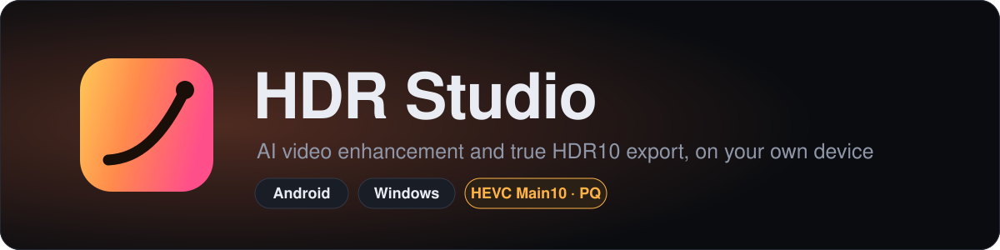
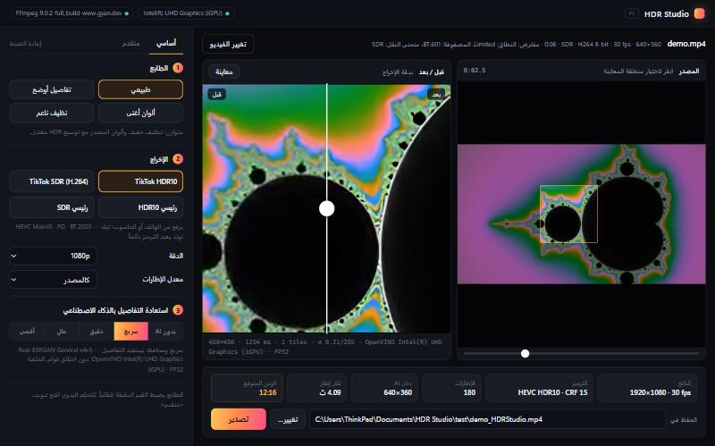

<p align="center">
  
</p>

<p align="center">
  <a href="https://github.com/6thd/HdrStudio/actions/workflows/build.yml"></a>
  <a href="https://github.com/6thd/HdrStudio/actions/workflows/pc-tests.yml"></a>
  
  
  
</p>

<p align="center">
  <b>تحسين الفيديو بالذكاء الاصطناعي وإخراج HDR10 حقيقي، على جهازك دون رفع أي شيء إلى خادم.</b><br>
  <sub>AI video enhancement and true HDR10 export. Runs entirely on your device: an Android app and a Windows app sharing one colour pipeline.</sub>
</p>

---

## التطبيقان

| | 📱 أندرويد | 🖥️ ويندوز |
|---|---|---|
| **لمن** | تحسين سريع على الهاتف نفسه | أعلى جودة ممكنة، ولو طال زمن المعالجة |
| **الكود** | [`app/`](app) · Java · OpenGL ES 3 | [`pc/`](pc) · Python · OpenGL 3.3 · FFmpeg |
| **استعادة التفاصيل (AI)** | Real-ESRGAN general‑x4v3 على GPU | general‑x4v3 و x2plus و x4plus عبر ONNX |
| **توليد إطارات 60fps** | — | RIFE v4.6 |
| **الإخراج** | HDR10 أو SDR عبر مرمّز الهاتف | HDR10 أو SDR عبر x265 / x264 |
| **الاستئناف بعد الانقطاع** | — | نعم، من حيث توقف |
| **الدليل** | [docs/ANDROID.md](docs/ANDROID.md) | [pc/README.md](pc/README.md) |

<p align="center">
  
  <br><sub>تطبيق ويندوز: اختيار منطقة من الإطار، مقارنة قبل/بعد بدقة الإخراج، وزمن التصدير المتوقع قبل البدء.</sub>
</p>

## ما يفعله

- **استعادة التفاصيل بالذكاء الاصطناعي** مع إرجاع القوام الدقيق وحماية البشرة، حتى لا تبدو الصورة بلاستيكية.
- **تنظيف** الضوضاء وآثار الضغط مكانياً وزمنياً بتتبع الحركة، ومنع التشريط في التدرجات.
- **حدة نهائية متكيفة بلا هالات.**
- **HDR متكيف حسب المشهد:** توسيع للإضاءات العالية فقط، مع حماية البشرة وبلا تشبّع مبالغ.
- **HDR10 صحيح البيانات:** HEVC Main10، ‏BT.2020، ‏PQ، وقيم MaxCLL / MaxFALL مقاسة من الإطارات نفسها.
- **فحص قبل الحفظ:** الوسوم، عدد الإطارات، الصوت، وبيانات HDR. الملف الذي لا يجتاز الفحص لا يُحفظ باسمه النهائي.

## ابدأ

### 🖥️ ويندوز

1. نزّل `HDRStudio-Setup-x.y.z.exe` من صفحة [Releases](https://github.com/6thd/HdrStudio/releases) وشغّله. لا يحتاج Python ولا صلاحيات مدير.
2. المثبِّت يعرض تثبيت FFmpeg إن لم يكن موجوداً.
3. اختر الفيديو، ثم الطابع والإخراج ومستوى AI، ثم «معاينة» و«تصدير».

للتشغيل من المصدر أو من سطر الأوامر: [pc/README.md](pc/README.md).

### 📱 أندرويد

الـAPK يُبنى عبر GitHub Actions من هذا المستودع ويُنزَّل كـartifact. الخطوات كاملة في [docs/ANDROID.md](docs/ANDROID.md).

## كيف يعمل

```
المصدر ─▶ منع التشريط ─▶ إزالة الضوضاء ─▶ تقدير الحركة ─┬─▶ AI (Real-ESRGAN) + إرجاع القوام ─┐
                                                        └─▶ المسار التقليدي ─────────────────┤
                                                                                              ▼
              الملف ◀─ فحص ◀─ ترميز HEVC/H.264 ◀─ خريطة HDR (PQ · BT.2020) ◀─ حدة ◀─ تثبيت زمني
```

التطبيقان يستخدمان ملفات الـshaders نفسها لمسار الألوان والتنظيف؛ ما يُختبر على الحاسوب هو ما يعمل على الهاتف.

## التوثيق

| الموضوع | الملف |
|---|---|
| تصميم تطبيق ويندوز وقراراته وقياساته | [pc/docs/DESIGN.md](pc/docs/DESIGN.md) |
| دليل تطبيق أندرويد والبناء | [docs/ANDROID.md](docs/ANDROID.md) |
| مسار الألوان | [docs/COLOR_PIPELINE.md](docs/COLOR_PIPELINE.md) |
| نموذج AI: المصدر والترخيص والبصمات | [docs/AI_MODEL.md](docs/AI_MODEL.md) |
| تقرير الاختبارات | [docs/TEST_REPORT.md](docs/TEST_REPORT.md) |
| سجل التغييرات | [docs/CHANGES.md](docs/CHANGES.md) |

## الجودة والاختبار

- **أندرويد:** اختبارات JVM لرياضيات الألوان والبيانات الوصفية وتحليل HEVC، تعمل مع كل بناء.
- **ويندوز:** اختبارات آلية على Python 3.12 إلى 3.14 لحماية واجهة API المحلية والتخطيط وترقيع HDR10 وتحويل النماذج. اختبارات التصدير والاستئناف الكاملة تحتاج GPU وتعمل محلياً.

## ما لا يدّعيه المشروع

- تحويل SDR إلى HDR يعيد توزيع الإضاءات العالية؛ لا يستعيد ضوءاً غير موجود في المصدر.
- لا Dolby Vision ولا HDR10+.
- منصات الرفع مثل TikTok تعيد ترميز كل ما يُرفع؛ الجودة النهائية هناك تتبع ترميزها أيضاً.
- AI على بطاقة مدمجة بطيء: دقائق لكل ثانية فيديو عند 1080p بالمستويات العالية.

## التراخيص

النماذج المضمَّنة تتبع تراخيص أصحابها: Real-ESRGAN ‏(BSD-3-Clause) و RIFE ‏(MIT). التفاصيل والبصمات في [docs/AI_MODEL.md](docs/AI_MODEL.md) و [pc/README.md](pc/README.md).
